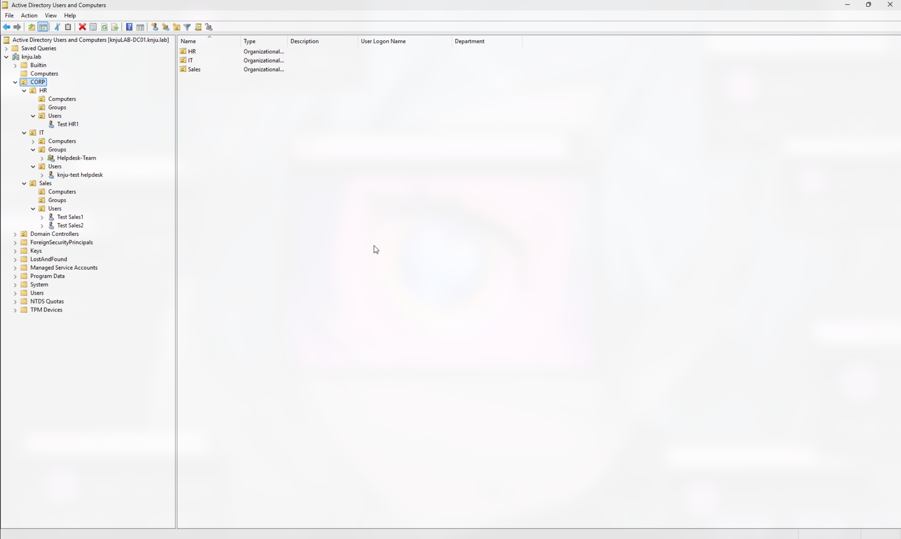

# 04 — Organizational Unit (OU) Structure & Data Population

## Objective
Design and implement an Organizational Unit (OU) hierarchy that mirrors a standard enterprise business structure. This structure will serve as the foundation for delegating administrative control (Phase 5) and automating identity lifecycles (Phase 6).

## Environment
- **Domain:** `knju.lab`
- **Tool:** Active Directory Users and Computers (ADUC)
- **Management Host:** `knjuLAB-DC01` (Domain Controller)

## Design Rationale
Rather than leaving all objects in the default `Users` container (which is a security and management anti-pattern), I designed a department-based OU structure. 

Key design decisions:
1. **Top-Level Business Unit:** Created a parent `CORP` OU to represent the organization. This allows for future scalability (e.g., if a second business unit or subsidiary is added).
2. **Departmental OUs:** Created `IT`, `HR`, and `Sales` OUs to separate user bases. This aligns with the principle of least privilege, as IT administrators can be granted rights to specific departments without affecting others.
3. **Standardized Sub-OUs:** Inside every department, I created `Users`, `Groups`, and `Computers` sub-OUs. Separating object types prevents Group Policy (GPO) conflicts and makes it easier to target specific policies (e.g., applying a stricter password policy only to `CORP\HR\Users`).

## Steps Taken
1. Opened **Active Directory Users and Computers** (ADUC).
2. Right-clicked the domain root (`knju.lab`) > **New** > **Organizational Unit**. Created `CORP`.
3. Inside `CORP`, created the departmental OUs: `IT`, `HR`, and `Sales`.
4. Inside each department, created three sub-OUs: `Users`, `Groups`, and `Computers`.
5. Populated the environment with test data to prepare for the Delegation of Control phase:
    - **Group:** Created a Global Security Group `Helpdesk-Team` in `CORP\IT\Groups`.
    - **Helpdesk Agent:** Created user `test.helpdesk` in `CORP\IT\Users` and added them to the `Helpdesk-Team` group.
    - **End Users:** Created `test.sales1` and `test.sales2` in `CORP\Sales\Users`. Created `test.hr1` in `CORP\HR\Users`.

## Verification
The screenshot below confirms the OU tree structure and the placement of the test users within their respective departments. 

## Key Takeaways
- **The default `Users` container cannot have Group Policy applied to it.** By creating custom OUs, I have enabled the future application of granular GPOs (e.g., locking down the HR OU).
- **Separation of object types matters.** Grouping `Users` and `Computers` in the same OU complicates GPO targeting. The standard practice is to keep them in separate sub-OUs.
- **Test data is essential.** Creating localized dummy data (`test.helpdesk`, `test.sales1`, `test.hr1`) provides the necessary subjects for testing security boundaries in the next phase.