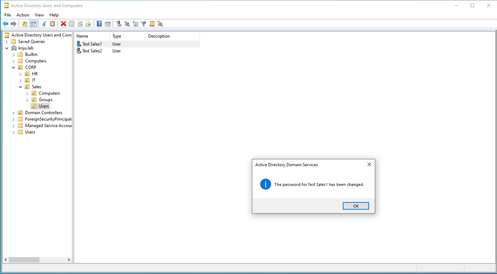
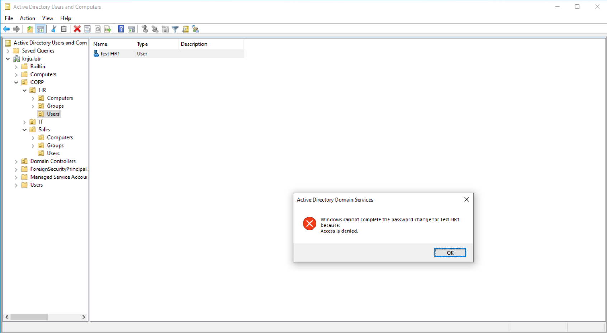

# 05 — Delegation of Control & Least Privilege

## Objective
Grant the `Helpdesk-Team` the ability to perform daily L2 support tasks (password resets, account unlocks, group membership changes) within the `Sales` OU, without granting them Domain Admin or Full Control over the OU. 

## Environment
- **Domain:** `knju.lab`
- **Target OU:** `knju.lab\CORP\Sales`
- **Delegated Group:** `knju.lab\CORP\IT\Groups\Helpdesk-Team`
- **Management Host:** `knjuLAB-DC01` (Domain Controller)

## Design Rationale (The Principle of Least Privilege)
In many entry-level labs, students grant a Helpdesk group "Full Control" over an OU. This is a security anti-pattern. An L2 technician needs enough permissions to clear the ticket queue, but they must not be able to create, delete, or escalate privileges.

I scoped the delegation to the following exact permissions:
- **Reset Password:** Allows the technician to set a new password and force a change at next logon.
- **Account Lockout (Read/Write):** Required to unlock accounts after failed logon attempts.
- **Group Membership (Write):** Required to add/remove users from standard security groups (e.g., adding a user to a "Sales-Team" distribution list).

**Explicitly Denied:** The Helpdesk team cannot create new user objects, delete user objects, or modify Domain Admin groups.

## Problems Encountered: The Active Directory GUI Limitation
I initially attempted to use the built-in **Delegation of Control Wizard** and the **Advanced Security Settings** GUI. However, I encountered a severe UI limitation: when restricting the delegation scope to specific objects (e.g., "Descendant User objects"), Windows Server dynamically hides the **"Extended Rights"** checkbox. This prevents the assignment of critical permissions like "Reset Password" through the graphical interface.

**The Solution:** To bypass this GUI flaw and ensure deterministic, repeatable results, I pivoted to the command line. I used `dsacls.exe`, the native Windows utility for managing Active Directory Discretionary Access Control Lists (DACLs). This approach is not only faster but aligns with how enterprise environments automate permissions at scale.

## Steps Taken (PowerShell / `dsacls`)
1. Opened an elevated PowerShell prompt on `KNJU-LAB-DC01`.
2. Executed the following commands to apply granular permissions to the `Sales` OU:

**Command 1: Grant Password Reset Rights**
```powershell
dsacls "OU=Sales,OU=CORP,DC=knju,DC=lab" /I:S /G "KNJU\Helpdesk-Team:CA;Reset Password;user"
```
*(Explanation: `/I:S` applies inheritance to all sub-objects. `/G` grants the permission. `CA` is the Control Access right for Extended Rights, specifically targeting `user` objects).*

**Command 2: Grant Account Unlock Rights**
```powershell
dsacls "OU=Sales,OU=CORP,DC=knju,DC=lab" /I:S /G "KNJU\Helpdesk-Team:WP;lockoutTime;user"
```
*(Explanation: `WP` is Write Property. Modifying the `lockoutTime` attribute is how Active Directory unlocks an account).*

**Command 3: Grant Group Membership Modification Rights**
```powershell
dsacls "OU=Sales,OU=CORP,DC=knju,DC=lab" /I:S /G "KNJU\Helpdesk-Team:WP;member;group"
```
*(Explanation: Allows the Helpdesk team to write to the `member` attribute of `group` objects within the Sales OU).*

## Verification (The Positive and Negative Tests)
*Note: To properly verify the security boundary, these tests must be run from a standard Windows 10/11 client machine joined to the domain, logged in as the `test.helpdesk` user.*

**Test 1: The Positive Test (Sales OU)**
- Logged into the client machine as `LAB\test.helpdesk`.
- Opened ADUC and navigated to `CORP\Sales\Users`.
- Right-clicked `test.sales1` and successfully reset their password and unlocked the account.
- **Result:** Success.


**Test 2: The Negative Test (HR OU)**
- Without logging out, navigated to `CORP\HR\Users`.
- Attempted to reset the password for `test.hr1`.
- **Result:** Failure. Windows returned an "Access Denied" error, confirming the ACL boundary is working.
- 
## Key Takeaways
- **The GUI can be limiting; ACLs are absolute.** The graphical wizards in Windows Server are prone to hiding necessary options. Learning to use `dsacls` provided a robust workaround.
- **Command-line delegation is scalable.** While clicking through the GUI is acceptable for a single OU, `dsacls` can be scripted to deploy identical security permissions across hundreds of OUs in seconds.
- **A security control is not complete until it is tested negatively.** Proving that the Helpdesk team *can* do their job in Sales is only half the equation. Proving they *cannot* cross the boundary into HR is the actual proof of security.