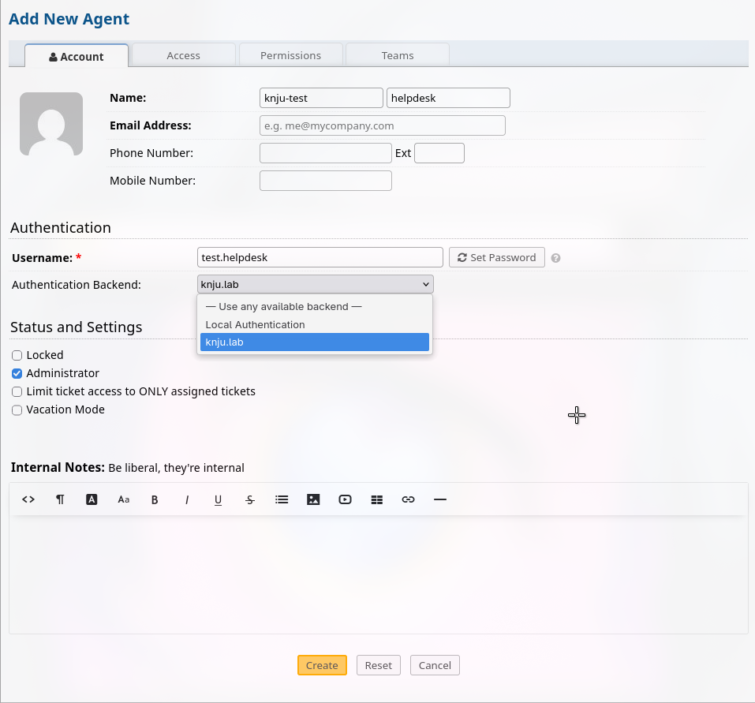
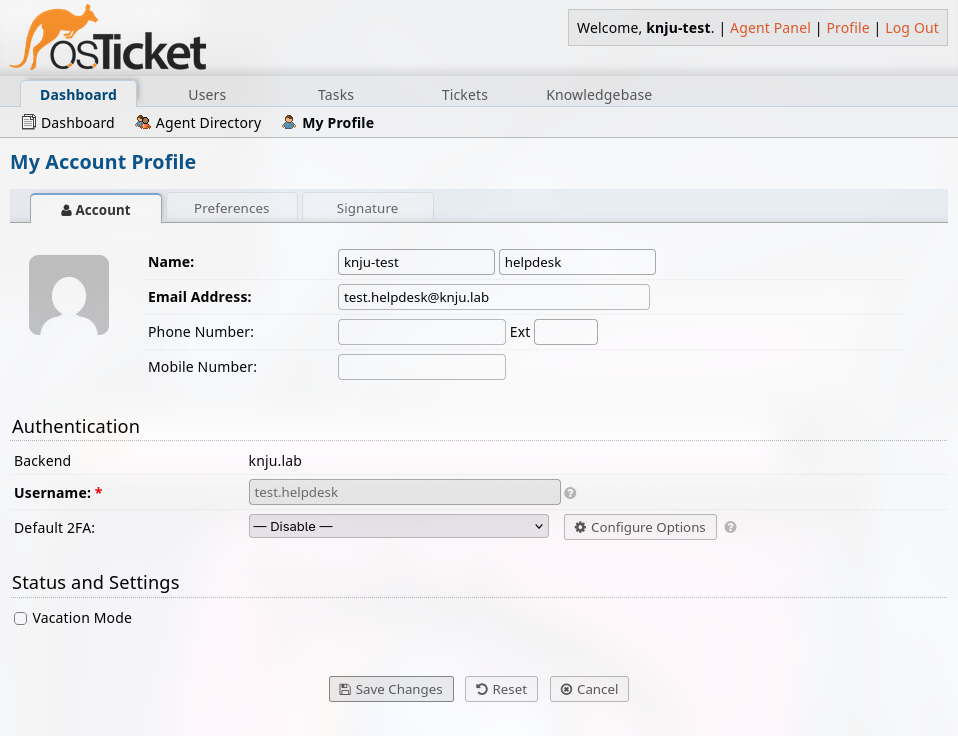

# 05 — Ticketing System (osTicket) & AD Integration

## Objective
Deploy and configure osTicket as the central service desk platform. The system is integrated with Active Directory for agent authentication and features a defined SLA framework to manage ticket lifecycles.

## Environment
- **OS:** Ubuntu Server 26.04.1 LTS VM
- **IP Address:** `192.168.122.20`
- **Stack:** LAMP (Apache, MariaDB, PHP)
- **Application:** osTicket
- **Integration:** Active Directory via LDAP Plugin

## Steps Taken
### 1. LAMP Stack Installation (PHP 8.2)
Because Ubuntu 24.04 ships with PHP 8.3 and osTicket requires PHP ≤ 8.2, I added the `ondrej/php` PPA to install PHP 8.2. I then installed Apache, MariaDB, and the required PHP extensions (`mysqli`, `gd`, `imap`, `intl`, `apcu`, etc.).

### 2. PHP & MariaDB Configuration
- **PHP:** Set `date.timezone` to `Europe/Madrid` and `memory_limit` to `512M` in `/etc/php/8.2/apache2/php.ini`.
- **MariaDB:** Ran `mariadb-secure-installation` to remove anonymous users and test databases. Created a dedicated `osticket` database and a corresponding `osticket` user with a strong password, granting privileges only to that database.

### 3. osTicket Deployment
- Downloaded the latest osTicket release from GitHub to `/var/www/html/`.
- Set ownership to `www-data:www-data` and permissions to `775`.
- Copied `ost-sampleconfig.php` to `ost-config.php` and made it read-only (`644`).

### 4. Apache Virtual Host
Created `/etc/apache2/sites-available/osticket.conf` with `DocumentRoot` pointing to `/var/www/html/osTicket/upload`. Enabled `mod_rewrite`, activated the site, and disabled the default site.

### 5. Web Installer & Post-Installation
Completed the web installer at `http://192.168.122.20/`, providing the database credentials and creating the primary admin account. Removed the `setup` directory to secure the installation.

### 6. Active Directory Integration (LDAP)
To ensure agents use their standard corporate credentials, I integrated osTicket with the domain controller.
- **Pre-requisite:** Ensured the main osTicket admin account was set to **Local Authentication** to prevent lockout if the LDAP service failed.
- **Plugin Installation:** In the Admin Panel, installed the **LDAP Authentication and Lookup** plugin.
- **Configuration:**
  - **Default Domain:** `knju.lab`
  - **DNS Servers:** `192.168.122.10`
  - **LDAP Servers:** `192.168.122.10`
  - **Search Base:** `OU=CORP,DC=knju,DC=lab`
  - **Search User:** `CN=Administrator,CN=Users,DC=knju,DC=lab`
  - **LDAP Schema:** Microsoft Active Directory
- **Agent Creation:** Created an agent account for `test.helpdesk` and set their **Authentication Backend** to the new LDAP instance. This user can now log in with their AD password.

### 7. SLA Framework Configuration
Defined the Service Level Agreements in the **Admin Panel > Manage > SLA Plans**.
- **Sev-A (Critical):** Grace Period: 1 hour (24/7 Schedule).
- **Sev-B (High):** Grace Period: 4 hours (24/7 Schedule).
- **Sev-C (Moderate):** Grace Period: 8 hours (Business Hours Schedule).
- **Sev-D (Low):** Grace Period: 72 hours (Business Hours Schedule).
*Note: SLA plans are assigned to Help Topics so the correct timer is applied automatically upon ticket creation.*

## Problems Encountered
### Issue 1: Ubuntu 26.04.1 PHP Repository Migration
**Symptom:** Attempting to add the `ondrej/php` PPA failed with `404 Not Found` for the `resolute` release.
**Resolution:** Removed the broken PPA source list and manually added the new Sury repository (`packages.sury.org`), which provides the required PHP 8.2 packages for Ubuntu 26.04.1.
### Issue 2: "Strong(er) authentication required" (Server 2025 Defaults)
**Symptom:** Attempting to bind to the DC on standard LDAP port 389 returned: `Bind failed: Strong(er) authentication required: Unable to bind to server`.
**Root Cause:** Windows Server 2025 strictly enforces LDAP signing by default. It rejects basic, unencrypted LDAP binds unless the connection is secured via TLS (LDAPS).
**Attempted Resolution:** I pivoted to LDAPS on port 636.
### Issue 3: LDAPS Handshake Failure (`errno=104`)
**Symptom:** Connecting to `ldaps://192.168.122.10:636` returned `write:errno=104` (Connection reset by peer) and `no peer certificate available`.
**Root Cause:** The Domain Controller was not presenting a valid certificate. 
**Troubleshooting Steps:**
1. Generated a self-signed certificate on the DC with the required Server Authentication EKU and FQDN in the SAN.
2. Used `ldp.exe` on the DC (testing `localhost:636`) to bypass network issues; it returned `Error 81: Fail to connect`, confirming the issue was local to the DC.
3. Checked `certlm.msc`: Ensured the certificate was copied to the **Trusted Root Certification Authorities** store (required for self-signed certs).
4. Verified **NETWORK SERVICE** had read permissions to the certificate's private key (required for NTDS).
5. Cleared the NTDS certificate cache in the registry (`HKLM\SOFTWARE\Microsoft\Cryptography\Services\NTDS\SystemCertificates\My\Certificates`).

## Verification
- **Agent Creation:** Successfuly created the `KNJU\test.helpdesk` agent, with authentication method set to LDAP

- **Agent Login:** Successfully logged into the osTicket agent panel using the `KNJU\test.helpdesk` credentials, proving the LDAP bridge is functional.

- **SLA Enforcement:** Created a test ticket via the client portal. The agent dashboard correctly displayed the SLA due time based on the assigned Help Topic.

## Key Takeaways
- **Local Admin Fallback:** Always maintain a local administrator account in osTicket. If the Domain Controller goes down for maintenance, LDAP logins will fail, and you need a way to access the system.
- **The Power of Search Base:** Setting the Search Base to `OU=CORP,DC=knju,DC=lab` scopes the LDAP query to the relevant organizational unit, keeping the lookup fast and secure.
- **Documentation is Key:** The integration steps (especially the LDAP configuration strings) are complex. Documenting them creates a repeatable runbook for future deployments.
