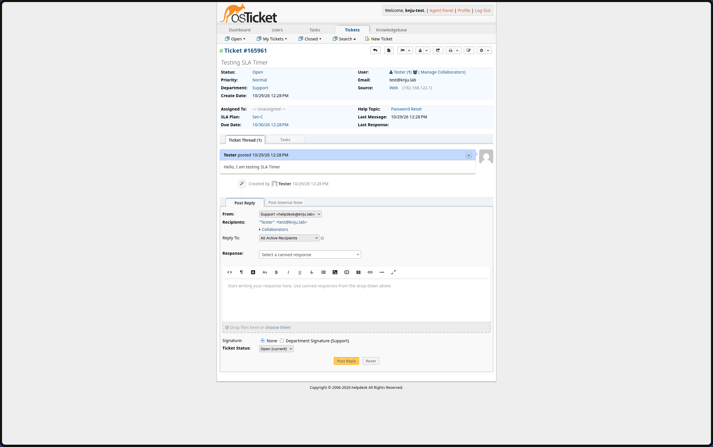

# 06 — SLA Framework Configuration

## Objective
Configure Service Level Agreements (SLAs) and business schedules in osTicket to enforce response and resolution targets, mimicking a real IT service management (ITSM) workflow.

## Environment
- **Platform:** osTicket (v1.18.1)
- **Access:** Admin Panel
- **Prerequisite:** Active Directory Integration (Phase 7)

## Design Rationale
An SLA is not just a number; it is a business contract. To prevent "false breaches" (where a ticket breaches SLA over the weekend while no one is working), I separated the SLAs into two categories based on severity:
- **Critical (Sev-A/B):** 24/7 clocks. These represent major outages that require immediate mobilization.
- **Moderate (Sev-C/D):** Business-hours clocks. These represent single-user issues that should be addressed during normal working hours.

## Steps Taken

### 1. Business Schedule Creation
Created a Schedule named `Business Hours (Mon-Fri 9-5)` in **Admin Panel > Manage > Schedules**. 
- Configured entries for Monday through Friday, `09:00` to `17:00`.

### 2. SLA Plan Creation
Created four SLA Plans in **Admin Panel > Manage > SLA Plans**:
- **Sev-A:** Grace Period `1` hour, Schedule `24/7`.
- **Sev-B:** Grace Period `4` hours, Schedule `24/7`.
- **Sev-C:** Grace Period `8` hours, Schedule `Business Hours (Mon-Fri 9-5)`.
- **Sev-D:** Grace Period `72` hours, Schedule `Business Hours (Mon-Fri 9-5)`.
- **Transient:** Left unchecked to ensure the SLA remains locked to the ticket and cannot be bypassed by transferring the ticket to another department.

### 3. Help Topic Integration (Automation)
Created Help Topics in **Admin Panel > Manage > Help Topics**:
- **Password Reset:** Assigned to the `Sev-C` SLA.
- **Network Outage:** Assigned to the `Sev-A` SLA.
- **Hardware Request:** Assigned to the `Sev-D` SLA.
- **Rationale:** Binding SLAs to Help Topics enforces the rules at the moment of ticket creation, eliminating manual triage errors by the Helpdesk agent.

## Verification
- **Test:** Created a test ticket via the Client Portal using the `Password Reset` Help Topic.
- **Result:** The ticket correctly displayed `SLA: Sev-C` and the due time reflected an 8-business-hour window. Had I created it under `Network Outage`, it would have assigned `Sev-A` with a 1-hour 24/7 clock.
-  **Screenshot:** 

## Key Takeaways
- **Schedules prevent false breaches.** Without schedules, a "4-hour" SLA on a Friday evening would expire by Saturday morning, creating false breaches and skewing metrics.
- **Help Topics are the automation engine.** By binding SLAs to Help Topics, the system enforces the rules at the moment of ticket creation, removing the risk of human error during triage.
- **Transient vs. Fixed SLAs.** Leaving the "Transient" box unchecked ensures the SLA is locked to the ticket. If it were transient, a Department transfer could reset the clock, invalidating the agreement.